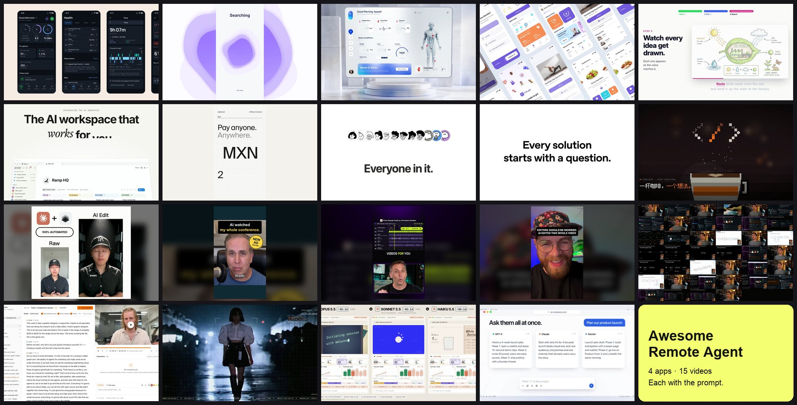
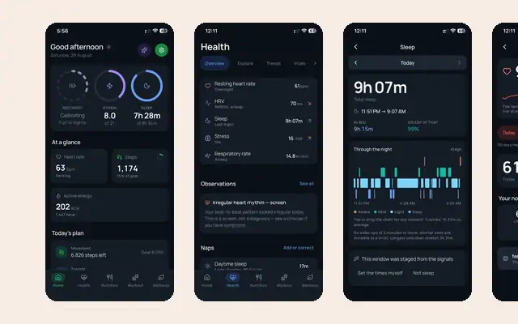
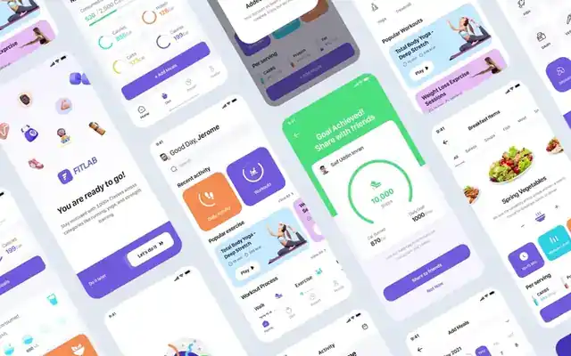
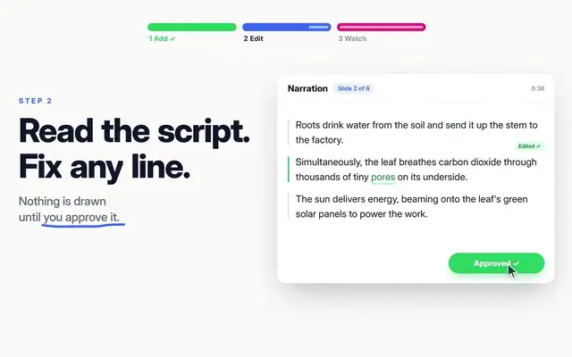
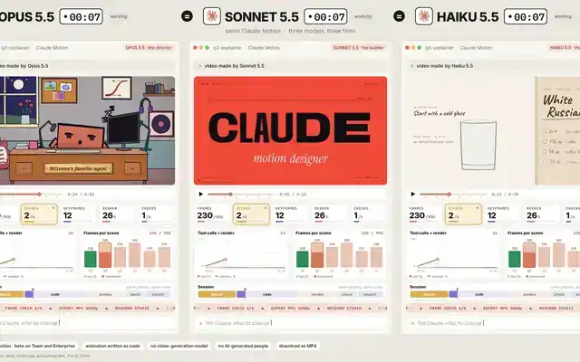

# Atu Marketplace

Apps and videos people loved, picked by the Hey Atu team. Pick one, say what to change, and [Hey Atu](https://heyatu.com/?utm_source=github&utm_medium=readme&utm_campaign=awesome-atu-marketplace&utm_content=intro) builds yours on your Mac: an app you open on your phone, or a finished video. Every pick comes with a prompt you can copy into Hey Atu, Claude Code, Codex or Pi.

Updated 2026-11-15. 11 picks.

## Contents

- [Health apps](#health-apps) (4)
- [Launch films](#launch-films) (4)
- [Intros & openers](#intros-openers) (3)
- [How a pick is chosen](#how-a-pick-is-chosen)
- [Credits and removal](#credits-and-removal)

## Health apps

Health and fitness apps people loved. Atu builds yours on your own data, as a Space you open on your phone or as a standalone app.

<table>
<tr><td width="50%" valign="top"> <b>Your wearable's app, without the subscription</b> Open-source app · <a href="https://github.com/OpenStrap/edge">OpenStrap</a> · ★ 924 stars <a href="prompts/openstrap-wearable-app.md">Prompt</a> · <a href="https://heyatu.com/?utm_source=github&utm_medium=readme&utm_campaign=awesome-atu-marketplace&utm_content=openstrap-wearable-app">Build mine with Atu</a></td><td width="50%" valign="top"> <b>A fitness app with playful motion</b> Designer's concept · <a href="https://dribbble.com/shots/9809369-Fitness-App-UI-Animation">tubik</a> · ♥ 767 likes <a href="prompts/fitness-app-motion.md">Prompt</a> · <a href="https://heyatu.com/?utm_source=github&utm_medium=readme&utm_campaign=awesome-atu-marketplace&utm_content=fitness-app-motion">Build mine with Atu</a></td></tr>
<tr><td width="50%" valign="top"> <b>A health tracker dashboard</b> Designer's concept · <a href="https://dribbble.com/shots/24693286-Health-Tracker-Dashboard-UI-UX-Design">Sigma Software Design</a> · ♥ 421 likes <a href="prompts/health-tracker-dashboard.md">Prompt</a> · <a href="https://heyatu.com/?utm_source=github&utm_medium=readme&utm_campaign=awesome-atu-marketplace&utm_content=health-tracker-dashboard">Build mine with Atu</a></td><td width="50%" valign="top"> <b>A diet and workout tracker</b> Designer's concept · <a href="https://dribbble.com/shots/20243423-Diet-Workout-Tracker-App-Design-Nutrition-Mobile-App-UI-UX">Musemind</a> · ♥ 415 likes <a href="prompts/diet-workout-tracker.md">Prompt</a> · <a href="https://heyatu.com/?utm_source=github&utm_medium=readme&utm_campaign=awesome-atu-marketplace&utm_content=diet-workout-tracker">Build mine with Atu</a></td></tr>
</table>

## Launch films

Product and feature films made by coding agents from a prompt. Give Atu your product and it makes yours.

<table>
<tr><td width="50%" valign="top"> <b>A 40-second showreel for your product</b> Made by an agent · <a href="https://x.com/ajith_io/status/2103469807375208546">@ajith_io</a> · ♥ 640 likes <a href="prompts/distilbook-launch-film.md">Prompt</a> · <a href="https://heyatu.com/?utm_source=github&utm_medium=readme&utm_campaign=awesome-atu-marketplace&utm_content=distilbook-launch-film">Build mine with Atu</a></td><td width="50%" valign="top"> <b>A SaaS launch film with real product shots</b> Made by an agent · <a href="https://x.com/moritzkremb/status/2103066071838466494">@moritzkremb</a> · ♥ 445 likes <a href="prompts/saas-launch-film.md">Prompt</a> · <a href="https://heyatu.com/?utm_source=github&utm_medium=readme&utm_campaign=awesome-atu-marketplace&utm_content=saas-launch-film">Build mine with Atu</a></td></tr>
<tr><td width="50%" valign="top"> <b>A punchy vertical promo for social</b> Made by an agent · <a href="https://x.com/davidmarcus/status/2103275618045686217">@davidmarcus</a> · ♥ 284 likes <a href="prompts/punchy-social-promo.md">Prompt</a> · <a href="https://heyatu.com/?utm_source=github&utm_medium=readme&utm_campaign=awesome-atu-marketplace&utm_content=punchy-social-promo">Build mine with Atu</a></td><td width="50%" valign="top"> <b>A trailer for one new feature</b> Made by an agent · <a href="https://x.com/wustep/status/2104610435571884086">@wustep</a> · ♥ 156 likes <a href="prompts/feature-trailer.md">Prompt</a> · <a href="https://heyatu.com/?utm_source=github&utm_medium=readme&utm_campaign=awesome-atu-marketplace&utm_content=feature-trailer">Build mine with Atu</a></td></tr>
</table>

## Intros & openers

Openers, title sequences and showreels made by coding agents. Use one at the start of a launch, a vlog or a channel.

<table>
<tr><td width="50%" valign="top"> <b>A music video, re-imagined overnight</b> Made by an agent · <a href="https://x.com/anabology/status/2103534482930491441">@anabology</a> · ♥ 16.5k likes <a href="prompts/music-video-reimagined.md">Prompt</a> · <a href="https://heyatu.com/?utm_source=github&utm_medium=readme&utm_campaign=awesome-atu-marketplace&utm_content=music-video-reimagined">Build mine with Atu</a></td><td width="50%" valign="top"> <b>Three openers, three models, one prompt each</b> Made by an agent · <a href="https://x.com/N01ennn/status/2108520767092597182">@N01ennn</a> · ♥ 1.5k likes <a href="prompts/three-model-showreel.md">Prompt</a> · <a href="https://heyatu.com/?utm_source=github&utm_medium=readme&utm_campaign=awesome-atu-marketplace&utm_content=three-model-showreel">Build mine with Atu</a></td></tr>
<tr><td width="50%" valign="top"> <b>A 15-second product intro</b> Made by an agent · <a href="https://x.com/ann_nnng/status/2103723183899852885">@ann_nnng</a> · ♥ 983 likes <a href="prompts/product-intro-film.md">Prompt</a> · <a href="https://heyatu.com/?utm_source=github&utm_medium=readme&utm_campaign=awesome-atu-marketplace&utm_content=product-intro-film">Build mine with Atu</a></td><td width="50%"></td></tr>
</table>

## How a pick is chosen

- **It shows the result.** You can see the finished app or video, not a script or a terminal.
- **People loved it.** Likes on X or Dribbble, or stars on GitHub, as of 2026-11-15.
- **You can have your own.** Apps run as a Space in Hey Atu on your own data, or as a standalone web app; videos render on your Mac.

Seen one that belongs here? [Open an issue](../../issues/new?title=Pick%3A%20) with the link.

## Credits and removal

Every original belongs to its maker; Hey Atu is not affiliated with them. The previews are short clips of the originals, credited and linked to the source. Picks marked “Designer's concept” were made by designers, not by agents; the prompt is ours. Made one of these and want it changed or removed? [Open an issue](../../issues/new?title=Change%20or%20remove%3A%20) or email support@heyatu.com, and we will act on it quickly.

Prompts written by Hey Atu and the build script: [MIT](LICENSE). Prompts by creators are quoted from their public posts.
